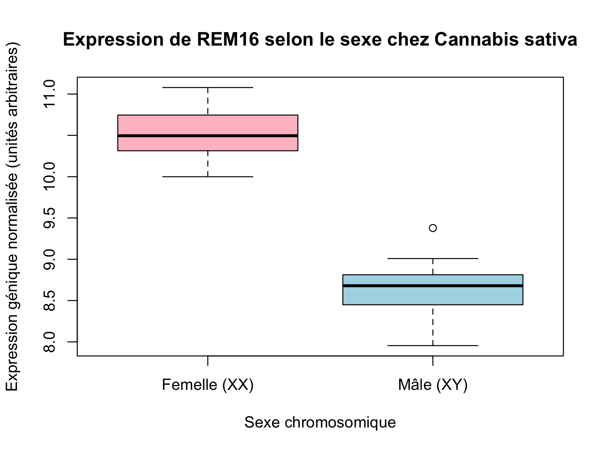
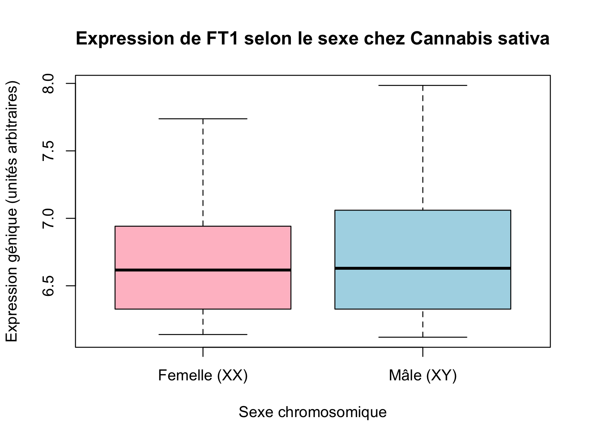
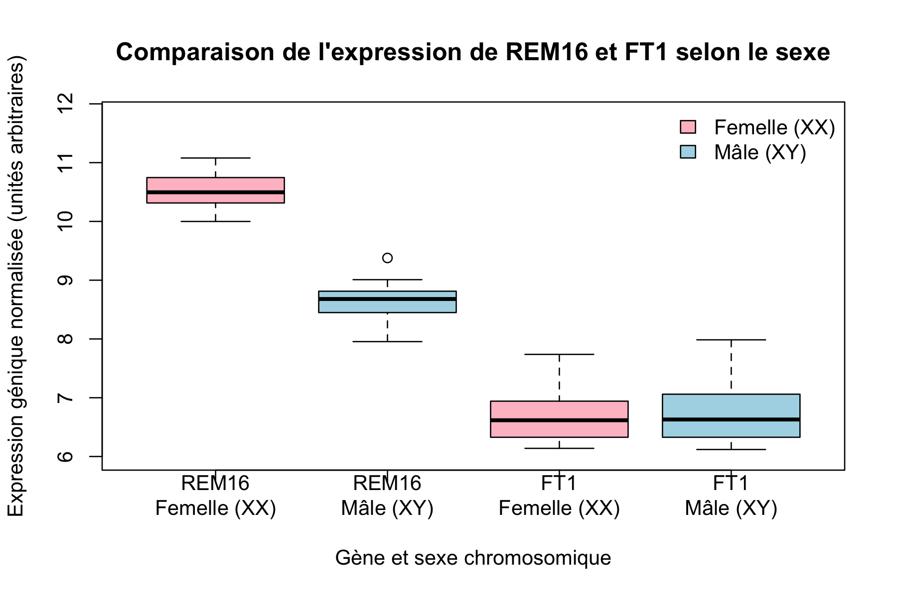

# Devoir 1 — oLLMpiques 2026 (BVG-7003)

Ce dépôt rassemble les livrables, les données et le pipeline d'analyse bioinformatique du Devoir 1 du cours BVG-7003. L'analyse principale (Tâche 3) évalue l'expression des gènes candidats *REM16* (`LOC115699937`) et *FT1* (`LOC115696989`) pour la discrimination sexuelle précoce chez *Cannabis sativa* à partir de données transcriptomiques (RNA-Seq) de 138 individus.

## Sommaire
1. [Contenu et organisation du dépôt](#1-contenu-et-organisation-du-dépôt)
2. [Détail des tâches réalisées](#2-détail-des-tâches-réalisées)
3. [Prérequis et dépendances](#3-prérequis-et-dépendances)
4. [Reproduire l'analyse (Tâche 3)](#4-reproduire-lanalyse-tâche-3)
5. [Aperçu des résultats et interprétation biologique](#5-aperçu-des-résultats-et-interprétation-biologique)

---

## 1. Contenu et organisation du dépôt

| Tâche | Description du livrable | Fichier / Dossier |
| :---: | :--- | :--- |
| **Tâche 1** | Initialisation et configuration du dépôt Git/GitHub | [`Question_1/README.md`](Question_1/README.md) |
| **Tâche 2** | Résumé condensé (exactement 250 mots) de Steen *et al.* (2013) | [`Question_2/Abstract.txt`](Question_2/Abstract.txt) |
| **Tâche 3** | Script R Markdown et rapport d'analyse de *REM16* et *FT1* | [`code/Devoir1.Rmd`](code/Devoir1.Rmd) / [`code/Devoir1.md`](code/Devoir1.md) |
| **Tâche 4** | Proposition d'une méthode à haut débit pour le sexage du cannabis | [`Question_4/Proposition.txt`](Question_4/Proposition.txt) |
| **Données** | Matrice d'expression RNA-Seq (138 plantes, > 34 000 gènes) | [`data/2_Data_RNASeq_Cannabis_Sex.csv`](data/2_Data_RNASeq_Cannabis_Sex.csv) |
| **Figures** | Graphiques générés automatiquement par le script de la Tâche 3 | [`figures/`](figures/) |

### Structure de l'arborescence
```text
Devoir_1_BVG-7003/
├── Question_1/
│   └── README.md                         # Validation de la configuration Git/GitHub
├── Question_2/
│   └── Abstract.txt                      # Résumé scientifique réduit à exactement 250 mots
├── Question_4/
│   └── Proposition.txt                   # Protocole de RT-qPCR multiplexe à haut débit (< 250 mots)
├── code/
│   ├── Devoir1.Rmd                       # Code source R Markdown reproductible et documenté
│   └── Devoir1.md                        # Rapport compilé avec statistiques et figures
├── data/
│   └── 2_Data_RNASeq_Cannabis_Sex.csv    # Matrice d'expression RNA-Seq d'entrée
├── figures/
│   ├── Figure1_REM16_boxplot.png         # Boxplot d'expression de REM16 selon le sexe
│   ├── Figure2_FT1_boxplot.png           # Boxplot d'expression de FT1 selon le sexe
│   └── Figure3_Combined_boxplot.png      # Boxplot comparatif combiné de REM16 et FT1
└── README.md                             # Documentation principale du dépôt
```

---

## 2. Détail des tâches réalisées

- **Tâche 1 — Préparation du dépôt GitHub :** Clonage du dépôt initial, création du dossier `Question_1/` et ajout d'un fichier `README.md` permettant le suivi du dossier par Git.
- **Tâche 2 — Réduction d'un résumé scientifique :** Condensation du résumé de l'article *Why Has the Number of Scientific Retractions Increased?* (Steen, Casadevall et Fang, *PLOS ONE*, 2013) de 500 mots à exactement 250 mots dans `Question_2/Abstract.txt`.
- **Tâche 3 — Analyse de l'expression de *REM16* et *FT1* :** Extraction des données d'expression de *REM16* (`LOC115699937`) et *FT1* (`LOC115696989`) chez 138 plants de *Cannabis sativa* femelles (`XX`) et mâles (`XY`), correction explicite d'une anomalie de formatage d'identifiant (`Cannabis_LOC115699937`) et génération de trois boxplots comparatifs.
- **Tâche 4 — Méthode de sexage transcriptomique à haut débit :** Proposition d'un protocole industriel économique (< 250 mots) combinant une lyse foliaire directe en plaques de 384 puits, une RT-qPCR *One-Step* multiplexée (*REM16* et *FT1*) et une assignation automatisée du sexe par calcul du `dCt`.

---

## 3. Prérequis et dépendances

L'analyse de la Tâche 3 est réalisée en **R** (version 4.0 ou supérieure) et utilise exclusivement des chemins relatifs portables (`../data/` et `../figures/`). Aucune modification du code ou des chemins d'accès n'est requise après le clonage du dépôt.

**Paquets R requis :** `dplyr`, `tidyr`, `rmarkdown` et `knitr`.

Pour installer les dépendances manquantes dans R, exécutez la commande suivante :
```r
install.packages(c("dplyr", "tidyr", "rmarkdown", "knitr"))
```

---

## 4. Reproduire l'analyse (Tâche 3)

Le script `code/Devoir1.Rmd` utilise des chemins relatifs portables. Il lit automatiquement le fichier `data/2_Data_RNASeq_Cannabis_Sex.csv`, corrige l'incohérence d'identifiant du gène *REM16* (`Cannabis_LOC115699937`), sépare les échantillons femelles (`_XX`) et mâles (`_XY`), et exporte les trois figures au format PNG dans le dossier `figures/`.

### Option A — Via RStudio (Méthode recommandée)
1. Ouvrez le fichier `code/Devoir1.Rmd` dans RStudio.
2. Cliquez sur le bouton **Knit** (RStudio définit automatiquement le dossier `code/` comme répertoire de travail, ce qui résout les chemins relatifs `../data/` et `../figures/`).

### Option B — En ligne de commande (Terminal) ou VS Code
1. Ouvrez un terminal (ou ouvrez le dossier racine `Devoir_1_BVG-7003` dans VS Code) et assurez-vous d'être placé à la racine du dépôt cloné :
   ```bash
   cd Devoir_1_BVG-7003
   Rscript -e "rmarkdown::render('code/Devoir1.Rmd')"

---

## 5. Aperçu des résultats et interprétation biologique

Les trois visualisations produites par le flux de travail se trouvent dans le dossier `figures/` :

### Figure 1 — Expression de *REM16* selon le sexe

*Légende : Le gène REM16 (LOC115699937) présente une forte surexpression chez les individus femelles (XX, médiane ~10,5) comparativement aux individus mâles (XY, médiane ~8,7), confirmant son utilité comme biomarqueur diagnostique du sexe femelle.*

### Figure 2 — Expression de *FT1* selon le sexe

*Légende : Le gène FT1 (LOC115696989) présente une distribution d'expression similaire et stable entre les femelles (XX) et les mâles (XY) autour d'une médiane de ~6,6, ce qui en fait un gène de référence interne approprié.*

### Figure 3 — Comparaison combinée de *REM16* et *FT1*

*Légende : Comparaison conjointe de l'expression des gènes REM16 et FT1 chez les plantes femelles (XX) et mâles (XY) sur une échelle commune.*

### Synthèse de l'interprétation biologique
- **Discrimination sexuelle par *REM16* :** L'absence de chevauchement entre les distributions interquartiles des femelles (`XX`) et des mâles (`XY`) démontre que le niveau d'expression de *REM16* suffit à discriminer de manière robuste le sexe chromosomique des individus.
- **Gène de contrôle *FT1* :** L'invariance d'expression de *FT1* entre les deux sexes valide son rôle de contrôle endogène stable, permettant de corriger les variations techniques d'extraction ou de quantité d'ARN initial lors d'un test diagnostique à haut débit (tel que le protocole RT-qPCR multiplexe détaillé dans `Question_4/Proposition.txt`).
